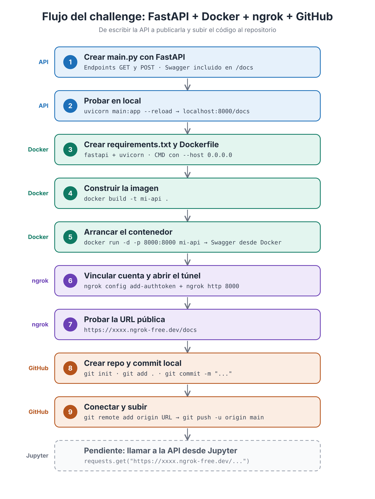

API sencilla con FastAPI, empaquetada en Docker y publicada con ngrok.
La documentación (Swagger) está disponible en `/docs`.

## Flujo del proyecto

## Cómo ejecutarlo

    docker build -t mi-api .
    docker run -d -p 8000:8000 mi-api
    ngrok http 8000

Después abre `http://localhost:8000/docs`.